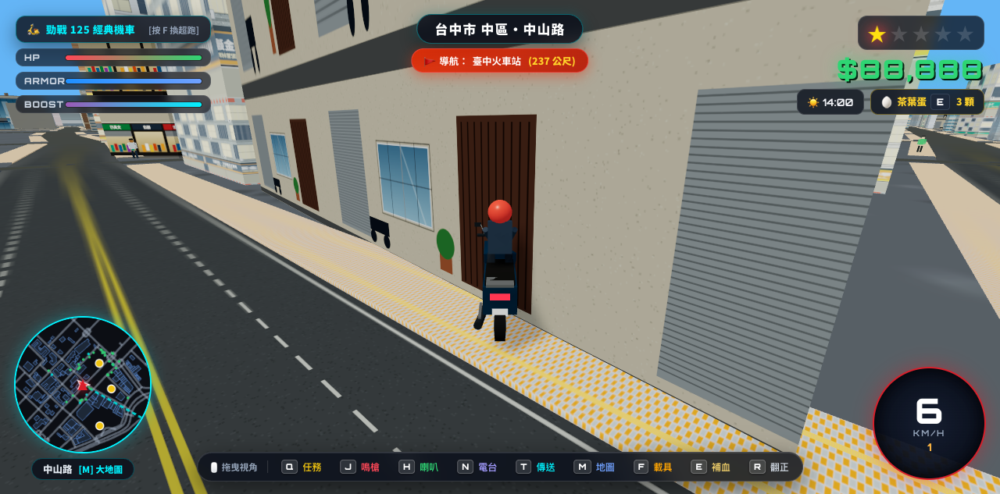

# 🇹🇼 TaichungGTA - 臺中開放世界 3D 街頭冒險 (Taichung Open World Web 3D)

> 基於真實臺灣臺中市真實地理圖資 (OpenStreetMap + Overture Maps) 與 Three.js / Cannon-es 打造的開放世界網頁 3D GTA 駕駛冒險遊戲。



## ✨ 核心特色 (Key Features)

### 1. 🛣️ 100% 真實臺中路網與無縫平整道路系統
- **完全修復道路與人行道交匯**：徹底消除舊版硬質路口旋轉方塊、路緣石切斷橫向車道與殘留破面問題。
- **無縫柏油重疊融合**：大小幹道、巷弄在十字路口、丁字路口、圓環平滑銜接。
- **行人專屬人行道收邊**：於路口外緣依幾何半徑精確停止，保留標準寬敞轉彎車道與視距。
- **高架快速道路**：台74線快速道路立體高架橋樑、雙向橋面、橋墩與物理碰撞體系。

### 2. 🏛️ 全程序化真實臺中 11 大地標建築 (100% Procedural Landmarks)
完全移除高延遲、大體積的 `.glb` 模型，改由精密幾何演算與高品質材質生成：
1. **臺中火車站 & 站前廣場**：1917 國定古蹟新文藝復興鐘樓、辰野金吾式紅磚白飾帶、綠銅瓦孟莎式雙折屋頂、古典柱廊與後方鋼構拱形桁架月台。
2. **李方艾美酒店 (原金沙大樓)**：中區 173 米摩天大樓、曲面藍灰雙色玻璃帷幕、基座石材柱列、頂層皇冠造型天頂。
3. **亞洲大飯店 / 榮達大樓**：臺灣大道經典 175 米階梯狀退縮石材立面高塔、細部格柵開窗與屋頂直升機停機坪。
4. **臺中國家歌劇院**：伊東豊雄「美聲涵洞」(Sound Cave) 有機曲面外牆、玻璃透光幕牆、屋頂空中花園與火山口形通風塔。
5. **東海大學 路思義教堂**：貝聿銘與陳其寬大師經典雙曲拋物面薄殼結構、金黃菱形琉璃面磚、脊線一線天玻璃採光帶與立體十字架。
6. **宮原眼科**：1927 日治古典巴洛克紅磚連續拱圈騎樓、深綠銅瓦折衷屋頂、老虎窗與山形山花牌樓。
7. **臺中第二市場 六角樓**：1917 百年歷史木造六角核心鐘樓、三翼放射狀傳統市場長廊。
8. **台中公園 湖心亭**：日月湖水面、雙尖頂重簷古典涼亭與曲橋。
9. **國立自然科學博物館 (科博館)**：白色現代幾何展示館群、44m 直徑太空劇場銀色球體、熱帶雨林玻璃溫室。
10. **國立臺灣美術館 (國美館)**：交錯懸挑現代展館群、落地玻璃天幕採光與戶外高音符號立體公共雕塑。
11. **大慶車站 (臺鐵/捷運綠線 G13)**：雙軌高架橋梁、立體 T 型橋墩、波浪形白色雙曲線月台遮雨棚與地面轉乘站體。

### 3. 🏪 臺灣在地特色街景分層立面系統
- **1 樓騎樓街屋**：早餐店、五金水電行、排骨飯便當、健保診所、7-11/全家便利超商、鐵捲門等多樣商圈招牌與立體側掛燈箱。
- **2 樓以上住宅立面**：臺灣經典二丁掛面磚、老舊鐵窗花、分離式冷氣室外機、外推陽台、洗石子外牆、水塔等細節。
- **頂點色彩變異**：每棟建築自動隨機色調與亮度，杜絕重複單調感。

### 4. 🎮 GTA 開放世界遊戲玩法
- **載具系統**：臺灣國民神車「勁戰 125 機車」與「經典超跑」，支援 [F] 鍵隨時切換。
- **通緝與鳴槍**：[J] 鍵車窗探頭鳴槍觸發警方通緝星級，警車將即時出動圍捕。
- **街頭任務**：[Q] 鍵接取外送、飆速與逃脫任務，賺取臺幣獎金。
- **快速傳送與導航**：[T] 鍵切換地標傳送、[M] 鍵全螢幕即時 GPS 互動地圖。
- **60 FPS 流暢效能**：動態區塊串流 (World Chunk Manager) 視錐體剔除與幾何合併。

---

## 🚀 執行方式 (How to Run)

只需靜態網頁伺服器即可直接遊玩，無需複雜建置環境：

```bash
# 使用 Python 內建伺服器
python3 -m http.server 8080

# 或使用 Node.js http-server / serve
npx serve -l 8080 .
```

在瀏覽器開啟 `http://localhost:8080` 即可進入遊戲！
